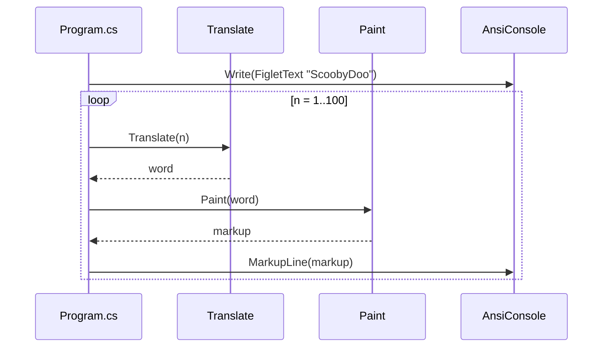

# Console Application

## Layout

```
Xakpc.Misc.ScoobyDoo/            (repository root)
├── CLAUDE.md
├── README.md                    (task, solution, run, video link)
├── video-demo-squeezed.mp4      (narrated recording, committed)
├── Xakpc.Misc.ScoobyDoo.slnx
├── .lode/
└── Xakpc.Misc.ScoobyDoo/
    ├── Xakpc.Misc.ScoobyDoo.csproj
    └── Program.cs
```

## Project settings (`Xakpc.Misc.ScoobyDoo.csproj`)

| Property | Value |
|---|---|
| Sdk | Microsoft.NET.Sdk |
| OutputType | Exe |
| TargetFramework | net10.0 |
| ImplicitUsings | enable |
| Nullable | enable |

Packages: `Spectre.Console` 0.57.2. No project references.

## Entry point

`Program.cs` uses top-level statements and two static local functions:

```csharp
AnsiConsole.Write(new FigletText("ScoobyDoo").Color(Color.Orange1));

for (var n = 1; n <= 100; n++)
{
    AnsiConsole.MarkupLine(Paint(Translate(n)));
}

static string Translate(int n) => (n % 5, n % 7) switch
{
    (0, 0) => "ScoobyDoo",
    (0, _) => "Scooby",
    (_, 0) => "Doo",
    _ => n.ToString(),
};
```

`Paint` maps a word to Spectre markup:

| Word | Markup |
|---|---|
| ScoobyDoo | `[bold orange1]Scooby[/][bold aqua]Doo[/]` |
| Scooby | `[orange1]Scooby[/]` |
| Doo | `[aqua]Doo[/]` |
| number | `[grey]{n}[/]` |



## Invariants and rationale

- Arm order in `Translate` is important. `(0, 0)` must be first. If not, 35 matches `(0, _)` and gives `Scooby`.
- `Translate` is pure and has no console dependency. `Paint` only adds color. Keep the rule and the presentation separate.
- `Paint` puts the number into markup without escaping. This is safe only because the text is digits. If `Paint` gets text that can contain `[` or `]`, use `Markup.Escape`.
- Colors: orange is Scooby's fur, aqua is his collar.
- When stdout is redirected or `NO_COLOR` is set, Spectre writes plain text with no ANSI codes.

## Build and run

```sh
dotnet build Xakpc.Misc.ScoobyDoo/Xakpc.Misc.ScoobyDoo.csproj
dotnet run --project Xakpc.Misc.ScoobyDoo
```

Manual check: the last 100 lines of redirected output. Line 5 = `Scooby`, line 7 = `Doo`, lines 35 and 70 = `ScoobyDoo`, line 98 = `Doo`, line 100 = `Scooby`.

- `bin/` and `obj/` are git-ignored.
- Git remote `origin`: https://github.com/xakpc/Misc.ScoobyDoo.git

Related: [../summary.md](../summary.md), [../terminology.md](../terminology.md), [../practices.md](../practices.md)
