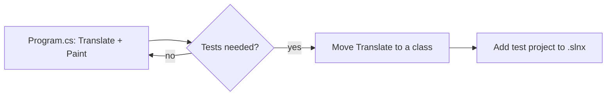

# Backlog

## Optional

- [ ] Add `Xakpc.Misc.ScoobyDoo.Tests` (MSTest + FluentAssertions) for `Translate`. The user selected no tests for now. To test `Translate`, move it from `Program.cs` into a public static class. See [../practices.md](../practices.md).
- [ ] Add Generic Host + DI + logging only if the app gets more than one service.

Related: [../app/summary.md](../app/summary.md)
