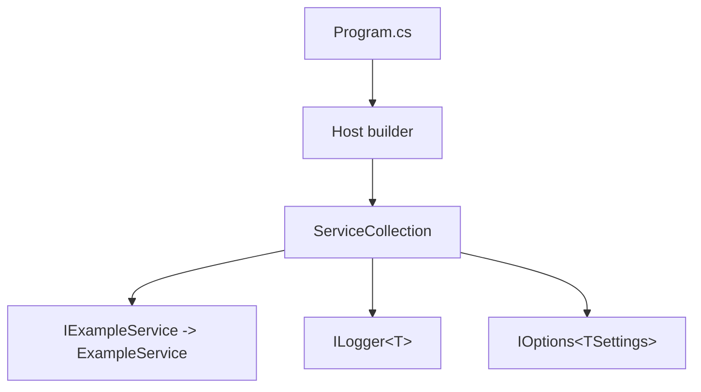

# Practices

Source: adapted from the awesome-copilot `dotnet-best-practices` skill.
Rule: apply a practice only when the code needs it. Do not add a framework (DI, config, AI) before a feature needs it.

## Current baseline (applies now)

- Target `net10.0`. Use current C# features (primary constructors, collection expressions, file-scoped namespaces).
- Keep `<Nullable>enable</Nullable>` and `<ImplicitUsings>enable</ImplicitUsings>`. Do not suppress nullable warnings without a reason in a comment.
- Use meaningful names that reflect domain concepts.
- Keep methods focused and cohesive. Obey SOLID.
- Use XML documentation comments on all public types and members, with `<param>` and `<returns>`.

## Structure

- Namespace pattern: `Xakpc.Misc.ScoobyDoo.{Core|Console|App|Service}.{Feature}`.
- Prefix interfaces with `I`. Keep interfaces small (interface segregation).
- Use the Factory pattern for complex object creation.
- For CLI commands, use a generic command handler base, e.g. `CommandHandler<TOptions>`.

```csharp
namespace Xakpc.Misc.ScoobyDoo.Core.Example;

/// <summary>Does one example thing.</summary>
/// <param name="clock">The time source.</param>
public sealed class ExampleService(IClock clock) : IExampleService
{
    private readonly IClock _clock = clock ?? throw new ArgumentNullException(nameof(clock));

    /// <summary>Gets the current UTC time.</summary>
    /// <returns>The current UTC time.</returns>
    public DateTimeOffset Now() => _clock.UtcNow;
}
```

## Dependency injection (when the app grows past one file)

- Use `Microsoft.Extensions.DependencyInjection` (or `Microsoft.Extensions.Hosting`).
- Use primary constructor injection. Validate with `ArgumentNullException`.
- Register with the correct lifetime: Singleton, Scoped, or Transient.



## Async

- Use async/await for all I/O and long operations. Return `Task` or `Task<T>`.
- Pass `CancellationToken` through async calls.
- In library code, use `ConfigureAwait(false)`. In the console entry point, it is not necessary.

## Configuration

- Use strongly typed settings classes with data annotations (`[Required]`).
- Bind with `IConfiguration` / `IOptions<T>`. Support `appsettings.json`.
- Validate options on start (`ValidateDataAnnotations().ValidateOnStart()`).

## Error handling and logging

- Use structured logging with `Microsoft.Extensions.Logging`. Use message templates, not string interpolation.
- Use logging scopes for context.
- Throw specific exceptions with clear messages. Catch only expected failures.
- Use resource files (`ResourceManager`) for user-facing messages only if localization becomes a requirement.

## Testing

- Framework: MSTest + FluentAssertions + Moq.
- Use the AAA pattern (Arrange, Act, Assert).
- Test success and failure paths. Include null parameter tests.
- Test project name: `Xakpc.Misc.ScoobyDoo.Tests`.

```csharp
[TestMethod]
public void Ctor_NullClock_Throws()
{
    // Arrange
    IClock? clock = null;

    // Act
    var act = () => new ExampleService(clock!);

    // Assert
    act.Should().Throw<ArgumentNullException>();
}
```

## Security and resources

- Validate and sanitize all input. Use parameterized queries for database access.
- Implement `IDisposable` / `IAsyncDisposable` correctly. Use `using` declarations.
- If the app uses AI, use `Microsoft.SemanticKernel` with structured output.

Related: [summary.md](summary.md), [app/summary.md](app/summary.md)
