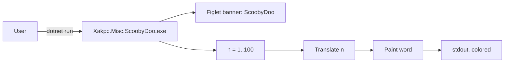

# Project Summary

Xakpc.Misc.ScoobyDoo is a .NET 10 console application that solves the ScoobyDoo exercise. The application writes the numbers 1 to 100, one for each line. For a multiple of 5 it writes `Scooby`. For a multiple of 7 it writes `Doo`. For a multiple of both (35, 70) it writes `ScoobyDoo`. The application uses `Spectre.Console` to write an orange Figlet banner and colored lines. All logic is in `Program.cs`, which uses top-level statements. The project has no tests. The user checks the output manually.

Related: [app/summary.md](app/summary.md), [terminology.md](terminology.md), [practices.md](practices.md), [plans/backlog.md](plans/backlog.md)
